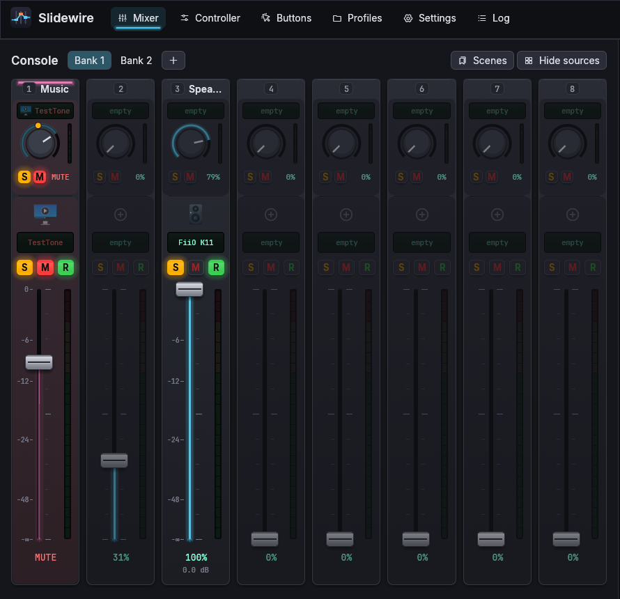
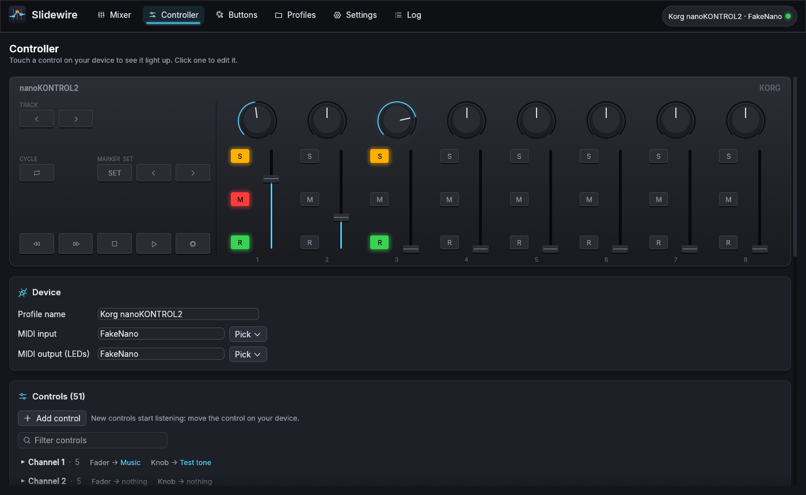

# Slidewire

Control the volume of individual apps and audio devices with a MIDI controller: faders for volume, buttons for mute, assign and default device, and LEDs that show the state. It's an independent Linux app inspired by MIDI Mixer for Windows. It shares none of that app's code and has no accounts, subscriptions or limits.



Built on KDE Plasma with PipeWire (or PulseAudio), and works on other desktops too:
- focus tracking works on KWin, Hyprland and sway
- the volume pop-up is Plasma's own, or a desktop notification elsewhere
- file dialogs go through the XDG portal

## Install

**Arch and derivatives:** build the package from the bundled PKGBUILD. `packaging/aur-release` builds the latest release; `packaging/aur` builds the newest code.

```sh
git clone https://git.briggen.dev/NilsBriggen/SlideWire.git
cd SlideWire/packaging/aur-release
makepkg -si
```

**Any distribution:** each [release](https://git.briggen.dev/NilsBriggen/SlideWire/releases) has an archive laid out like `/usr`. It contains the program, menu entry, icons, systemd unit, man page and shell completions.

```sh
sudo tar -xzf slidewire-1.0.0-x86_64.tar.gz --strip-components=1 -C /
```

**From source** (Rust 1.95 or newer):

```sh
cargo build --release
sudo scripts/install.sh /            # or: ./target/release/slidewire --install-icon
```

Slidewire needs `libpulse` and `alsa-lib`, which any desktop with sound already has.

**Uninstall:**
- Package: remove it with your package manager.
- `--install-icon` setup: run `slidewire --uninstall`, which removes the menu entry, the icons and autostart.
- Your settings stay in `~/.config/slidewire` until you delete that folder.

The package also installs a systemd user unit. With it, **Start when I log in** enables `slidewire.service`, which starts with your session and restarts if it ever crashes.

## First run

A short welcome walks you through it: pick your controller, move a control to check it arrives, then assign your first app.

A **Korg nanoKONTROL2** profile is created automatically:

| Control | Does |
|---|---|
| Fader 1–8, Knob 1–8 | volume of whatever the strip is assigned to |
| M 1–8 | mute toggle |
| S 1–8 | assign: press while an app is focused to put it on that strip; press again to clear |
| R 1–8 | run: makes an assigned device the default (or launches an assigned app) |
| Play / Stop / ◀◀ / ▶▶ | media keys (MPRIS: Spotify, browsers, mpv, ...) |
| Track ◀ / ▶, Cycle | previous / next bank (the Cycle LED is lit on banks 2 and up) |
| Record | mute all microphones (the LED is lit while they're muted) |

Profiles created before banks existed keep their old button setup; set Track and Cycle to **Previous/next bank** on the **Buttons** page.

## The window

The **Mixer** page looks like a console:
- one channel strip per hardware channel: knob on top, fader below
- each part has a scribble-strip display with the app or device icon, glowing **S**/**M**/**R** buttons, an LED meter, and the volume in % and dB
- to assign, drag an app or device from the **Sources** panel on the right onto a strip, or click a strip's **S** button (right-click works too)
- faders and knobs can be dragged, scrolled, or double-clicked to jump to 100%
- each app in the Sources panel has a **Play on…** menu to move it to another output
- **Banks**: the tabs above the console. Each bank has its own assignments, so 8 faders can control 16, 24, ... things.
- **Scenes**: save every strip's volume and mute under a name, and recall it from the Scenes menu, a button or the tray.
- **Master**: a fixed strip at the right end controls the default output; click its display to switch outputs. It appears when the window is wide enough.
- Right-click a strip to **name** it, give it a **colour** (a band on top, its glow and its display), pick an **icon**, or **clear** it.
- Faders are marked in dB. Each strip can also have its own range, e.g. a mic that never goes below 40%, and its own curve.
- **Ducking**: set a strip (Discord, say) to "Turn other apps down while this plays". Music on the other strips then dips by the amount you choose whenever it plays, and comes back after.
- In the Sources panel, an app with several streams (a game, a browser) gets one row. A filter box appears when the list is long.
- **Buses**: virtual outputs such as Game, Chat or Music, added in the Sources panel. Put apps on a bus with their **Play on…** menu, then one fader controls them all. Each bus plays on an output you choose. Buses stay in place when Slidewire quits, so the sound keeps flowing.
- **Always play here**: tick it in an app's **Play on…** menu, and the app goes back to that device whenever it starts.
- **Learn controls**: in a strip's menu, point its fader or buttons at different controls by touching them.

Mistakes are cheap: removing an assignment, clearing a strip, deleting a scene and recalling a scene all show a toast with **Undo**. **Ctrl+Z** / **Ctrl+Shift+Z** step through changes to assignments and the profile.

**Keyboard** (F1 shows the list):
- **Ctrl+1…6** switch pages
- **1…9** pick a channel strip; then **↑/↓** move its fader and **M** mutes it
- **Ctrl+F** filters the sources

**Look:** Settings → Appearance has:
- dark, light, or follow the desktop
- an accent colour (or the desktop's)
- the size of everything (Ctrl + / Ctrl − also work)
- Reduce motion

**Accessibility:**
- Screen readers get a name and value for every fader, knob and button.
- Faders and knobs take keyboard focus: the arrow keys move them by 2%, Page Up/Down by 10%, and Home/End jump to the ends.

**Tray:**
- closing the window keeps Slidewire running there; Settings → General can make the close button quit instead
- the icon gets a mute badge while the output is muted
- scrolling over it changes the volume
- its menu has scenes, banks, mic mute and profiles

**Pick up (soft takeover):** when a volume changed somewhere else (another app, a scene, a bank switch), the fader doesn't jump it on the next touch. It takes over once it reaches the current volume; until then the mixer shows where your fader is in amber. Settings → Volume → Pick up.



The **Controller** page draws your nanoKONTROL2 live: touch a control and it lights up, and the LEDs show what the device should be showing. Click a control in the drawing to edit it. Other controllers get a tile view.

Each strip can control any combination of:
- the focused app
- specific apps (matched by name, `*` wildcards or regex, so they survive app restarts)
- an app's recording stream
- "all other apps"
- system sounds
- any output or input device, or the current default device

Buttons outside the strips (**Buttons** page) can:
- send media keys, to whichever player is playing or to one you name
- toggle mutes
- set or cycle the default device
- run a command or press keys
- switch profile, bank or scene
- mute all inputs, or act as push-to-talk / push-to-mute
- control **OBS Studio**: switch scene, mute a source, start or stop recording or streaming. Set the obs-websocket address and password under Settings.
- **hear yourself**: play an input (or a bus) live on your headphones; press again to stop
- load an **EasyEffects** preset, for example with and without noise suppression

**When an app has focus** (Profiles page): switch to a bank or recall a scene while an app is in front, and go back when you leave it.

**nanoKONTROL2 LEDs:** the device only lets the computer drive its button LEDs in *External* LED mode. Set it once with Korg's KONTROL Editor (it runs under Wine). In the default mode everything works, but the LEDs only light while a button is held. **Settings → Test LEDs** lights each one in turn, so you can check.

## Other controllers

- **Profiles → Import** reads profiles from MIDI Mixer for Windows (`spec.json` files, found in that app's `profiles/` folder), so presets for the X-Touch Mini, X-Touch Extender, Platform M+, LPD8, MPK Mini and others work directly.
- To build your own, use **Controller → Add control**: new controls start in learn mode, so you just move the knob. Then group controls into strips.
- Supported input types:
  - 7-bit CC and notes
  - 14-bit pitch-bend (motor) faders
  - endless encoders (sign-bit, two's complement and offset-64 encodings)
- Supported feedback:
  - LED rings
  - button LEDs
  - motor faders
  - Mackie-style peak meters

## Controller not showing up?

Click the device status in the top right corner (or run `slidewire --doctor`). It checks the chain from USB to the MIDI port:
- is the device on USB
- is its sound driver loaded
- is it in the ALSA sequencer
- was the kernel updated without a reboot (then new devices can't load their drivers)
- could Slidewire open it

If the ALSA sequencer doesn't know the device, Slidewire opens its raw MIDI device (`/dev/snd/midiC*D*`) instead, so it keeps working. A replugged controller reconnects right away.

## Command line

```
slidewire --minimized        start in the tray
slidewire --list-ports       show MIDI ports
slidewire --monitor [name]   print incoming MIDI (debug a controller)
slidewire --doctor [name]    check why a controller doesn't show up
```

Running `slidewire` while it's already running brings the window up.

Control the running app, for scripts and keyboard shortcuts:

```
slidewire strips                     list strips with volume and assignment
slidewire set STRIP 50|+5|-5         set or change a strip's volume (percent)
slidewire mute STRIP [on|off|toggle]
slidewire bank N
slidewire scene NAME
```

`STRIP` is a strip name like `"Knob 3"`, or a number for that fader.

The full reference is in `man slidewire`; bash, zsh and fish complete the commands.

## Files

- `~/.config/slidewire/settings.json`
- `~/.config/slidewire/profiles/*.json` (plain JSON in the same format as the Windows app, plus `assignments`, `banks`, `scenes` and `buttons`)
- every save keeps the previous version as `*.json.bak`; a settings file that can't be read is kept as `settings.json.broken`

Other details:
- Settings and profiles can only be read by you. If one gets damaged, its previous version is used.
- Set `SLIDEWIRE_CONFIG=/some/dir` to use another config directory.
- Settings from the old `~/.config/midimixer/` are copied over on first start.

**Logs and crashes:**
- The Log page shows what happened.
- Running as the systemd service, the same goes to the journal: `journalctl --user -u slidewire`.
- A crash is written to `~/.local/state/slidewire/crash.log`, and the service restarts.

## Translating

User-visible text is written as `t!("English text")`. To add a language:
1. Copy `locales/en.json` to `locales/<code>.json` (for example `de.json`).
2. Translate the values, keeping `%{name}` placeholders as they are.
3. Build.

Slidewire uses the desktop's language and falls back to English for anything untranslated. After changing strings in the code, run `scripts/i18n-extract.py`.

## Testing without hardware

`cargo run --example fake_nano` creates a virtual nanoKONTROL2. Type commands on its stdin:
- `f 1 64`: fader 1 to the middle
- `b 48`: press M1

It prints the LED messages the app sends back.

`cargo test` checks things like:
- buses and their loopbacks, and that imported profiles can't run commands unasked
- config recovery and file permissions
- that every translatable string is extracted
- the MIDI mapping, volume range and dB math
- the ducking envelope
- the undo history
- theme contrast
- profile compatibility
- the parsers for portal, Hyprland and sway messages, and the OBS login

To also test importing the Windows app's profiles, point `SLIDEWIRE_WINDOWS_PROFILES` at a copy of its `profiles/` folder.

`scripts/screenshot.sh OUT_DIR mixer controller ...` screenshots the pages on a private X server (Xvfb), driven by the fake controller and a silent test stream. Nothing shows up on your desktop and none of your own audio streams are touched. Two variables adjust a shot:
- `PRE_SHOT='xdotool ...'` runs commands on that display before each shot: clicks, drags, or `echo "b 59" >"$NANO"` for controller input.
- `SETTINGS='{"theme":"light"}'` overrides settings for the shot.

## Contributing

See [CONTRIBUTING.md](CONTRIBUTING.md). Bug reports go to the [issue tracker](https://git.briggen.dev/NilsBriggen/SlideWire/issues). Please include the output of `slidewire --version` and `slidewire --doctor`.

## License

GPL-3.0-or-later, see `LICENSE`. Bundled fonts:
- Inter and JetBrains Mono (OFL)
- the Phosphor icon font (MIT)
- egui's built-in fonts (Ubuntu Font Licence and OFL)

See `assets/fonts/README.md`.
